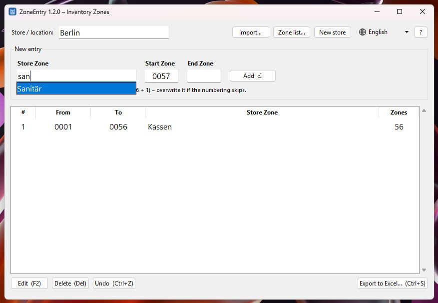
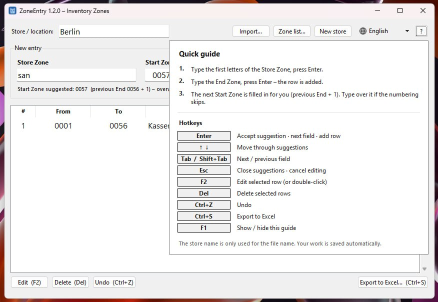

# ZoneEntry

**Fast data entry for store inventory counts.** Type a few letters of a Store Zone, type the last Inventory Zone,
press Enter. ZoneEntry fills in the next Start Zone for you and exports everything to Excel in the standard
`from | to | Division` layout.



* Keyboard-first: one row takes about two seconds, no mouse needed
* Start Zone is filled in automatically (previous End + 1, with leading zeros)
* Store Zones autocomplete as you type, tolerant of umlauts (`sanitaer` finds *Sanitär*)
* Warns about overlapping ranges and skipped zone numbers
* Saves your work automatically, so a crash or a closed window never loses a count
* Available in **English, Română, Magyar, Polski and Deutsch**
* Runs on older laptops: small, quick to start, no internet connection needed

---

## Contents
[Install](#install-windows-10--11) · [Quick start](#quick-start) · [Hotkeys](#hotkeys) · [Languages](#languages) ·
[The Excel file](#the-excel-file) · [Troubleshooting](#troubleshooting) · [For IT](#for-it-administrators) ·
[For maintainers](#for-maintainers)

---

## Install (Windows 10 / 11)

Requires Windows 10 or 11 (64-bit). **No administrator rights needed.**

### Option 1: Installer (recommended)

1. Open the **[Releases page](../../releases/latest)** and download **`ZoneEntry-Setup.exe`**.
2. Double-click it.
   *If Windows shows a blue **"Windows protected your PC"** window: click **More info**, then **Run anyway**.
   This appears because the program is not digitally signed; it is expected.*
3. Click **Next**, then **Install**, then **Finish**. A desktop shortcut is created (you can untick that).

Start ZoneEntry from the desktop icon or the Start menu.

**Update:** download the new `ZoneEntry-Setup.exe` and run it. It replaces the old version; your zone list,
language and saved work are kept.

**Uninstall:** Windows **Settings → Apps → Installed apps → ZoneEntry → Uninstall**.
Your data folder (see [Where your data lives](#where-your-data-lives)) is left in place; delete it by hand if you want it gone.

### Option 2: Portable (no installation)

Download **`ZoneEntry-portable.zip`** from the Releases page, extract it somewhere on your **local disk**
(not on a network drive or USB stick; those make the app slow to start), and run `ZoneEntry\ZoneEntry.exe`.

---

## Quick start



A row records one Store Zone and the range of Inventory Zones (shelf codes) inside it.

| | You do | ZoneEntry does |
|---|---|---|
| **1** | Type the first letters of the **Store Zone**, e.g. `san`, and press **Enter** | Shows matching zones as you type. Enter takes the top one (*Sanitär*) and jumps to **End Zone** |
| **2** | Type the **End Zone**, e.g. `56`, and press **Enter** | Pads it to `0056`, adds the row, then fills the next **Start Zone** (`0057`) and puts the cursor back in Store Zone |

So a typical row is just: `kas` ⏎ `42` ⏎

**Good to know**

* **First row:** there is no previous End yet, so type the Start Zone yourself (e.g. `1`, it becomes `0001`).
* **Numbering skips?** Type over the suggested Start Zone. The status bar tells you which zones were skipped.
* **Same Store Zone twice?** That's fine, add as many rows per zone as you need.
* Zone numbers are 4 digits, `0001` to `9999`. Short input is padded automatically (`7` becomes `0007`).
* The **store name** at the top is only used for the suggested file name when you export.

**The buttons**

| Button | What it does |
|---|---|
| **Import…** | Load an earlier `from / to / Division` Excel file and carry on where you stopped |
| **Zone list…** | Add or remove Store Zone names (one per line) |
| **New store** | Clear all rows and the store name for the next store. Warns if you have not exported yet; you can still undo |
| **🌐 Language** | Choose the language of the program |
| **?** | Hover for a quick guide with all hotkeys. Click it (or press F1) to keep it open |
| **Edit / Delete / Undo** | Fix mistakes. Or double-click a row to edit it |
| **Export to Excel…** | Save everything as an `.xlsx` file |

**Safety nets**

* **Overlap warning:** if a new range overlaps an existing row, you are asked before it is added.
* **Gap hint** (bottom right): shows zone numbers no row covers, e.g. `not covered: 7748–7749`.
  A jump into a new thousand block (for example 6397 → 7001) is treated as intentional and not reported.
* **Undo** goes back up to 200 steps.
* **Autosave:** every change is saved automatically. Close the program, even by accident, and your list is back next time.

---

## Hotkeys

| Key | Action |
|---|---|
| **Enter** | Accept the suggestion · go to the next field · add the row |
| **↑ ↓** | Move through the suggestions |
| **Tab / Shift+Tab** | Next / previous field |
| **Esc** | Close the suggestions · cancel editing |
| **F2** (or double-click) | Edit the selected row |
| **Delete** | Delete the selected rows |
| **Ctrl+Z** | Undo |
| **Ctrl+S** | Export to Excel |
| **F1** | Show / hide the quick guide |

---

## Languages

Click the **globe button** at the top right and pick **English, Română, Magyar, Polski or Deutsch**.
The whole program switches immediately, and your choice is remembered.

* On the first start ZoneEntry uses your Windows display language if it is one of these five.
* Store Zone names (*Sanitär, Kassen, Außenbereich …*) are data and are **never** translated.
* The column headers in the Excel file (`from`, `to`, `Division`) are part of the file format and stay the same in every language.
* The Windows file-open and file-save windows are provided by Windows and follow your Windows language.

---

## The Excel file

Exported files use exactly this layout, so downstream tools keep working:

| from | to | Division |
|---|---|---|
| 0001 | 0011 | Windfang |
| 0012 | 0042 | Kassen |
| … | … | … |

* Sheet name `Tabelle1`, headers in row 1, one row per entry
* All cells are **text**, so `0042` keeps its leading zeros (they are not turned into the number 42)
* Font Aptos Narrow 11 and the usual column widths

The suggested file name is `ZoneUpdate_<store name>_<date>.xlsx`.

---

## Troubleshooting

| Problem | What to do |
|---|---|
| **"Windows protected your PC"** when starting the installer | Click **More info → Run anyway**. The program isn't code-signed, so Windows asks once. |
| Antivirus blocks or quarantines the program | Ask IT to allow it. IT can check the file against `SHA256SUMS.txt` on the Releases page. See [For IT](#for-it-administrators). |
| *"…can't be written. Is it open in Excel?"* when exporting | Close the Excel file with that name, or export under another name. |
| *"'xyz' is not in the Store Zone list"* | Check the spelling, or add the zone via **Zone list…**. |
| Start Zone is empty | It is the first row (type it yourself), or the previous End was 9999. |
| I cleared the list by mistake | Press **Ctrl+Z**. Undo also brings back a list cleared with **New store** or replaced by **Import…** |
| The window looks cut off on a small screen | Maximise it. ZoneEntry adapts to screens as small as 1366 × 768. |
| Wrong language | Click the globe button and choose another one. |
| Slow to start on an old PC | Use the installer (not the zip on a network drive or USB stick), and ask IT to exclude the install folder from real-time virus scanning. |

---

## Where your data lives

Everything stays on your PC, in `%APPDATA%\ZoneEntry` (paste that into the Explorer address bar to open it):

| File | Contents |
|---|---|
| `zones.txt` | Your Store Zone list. Plain text, one name per line. Delete it to get the default list back |
| `session.json` | Your current rows, store name and last export folder (the autosave) |
| `settings.json` | The chosen language |

---

## For IT administrators

* **No admin rights needed:** the installer installs for the current user only, into `%LOCALAPPDATA%\Programs\ZoneEntry`.
* **No network access:** the program never connects to the internet and sends no telemetry.
* **Writes only to:** its install folder (installer only), `%APPDATA%\ZoneEntry`, and the Excel files the user exports.
* **Not code-signed.** Verify downloads with the SHA-256 values in `SHA256SUMS.txt` on the Releases page
  (`Get-FileHash .\ZoneEntry-Setup.exe -Algorithm SHA256`).
* Built with PyInstaller (Python 3.12, Tkinter, openpyxl). Source code and the build recipe are in this repository.
* **Silent install:** `ZoneEntry-Setup.exe /VERYSILENT /NORESTART` (per user), or add `/ALLUSERS` to install
  for all users (this one needs admin rights and installs into Program Files).
* **Silent uninstall:** `"%LOCALAPPDATA%\Programs\ZoneEntry\unins000.exe" /VERYSILENT`
* **Self-check:** `ZoneEntry.exe --selftest` opens the window, switches through all languages, writes and re-reads an
  Excel file, then exits. Exit code `0` means everything works. Details are written to `%TEMP%\zoneentry-selftest.log`.

---

## For maintainers

### Project layout

```
app.py              the main window: layout, language switching, table, export/import
widgets.py          autocomplete box, number fields, hover guide, dialogs, zone-list editor
zonelogic.py        all rules, no GUI: padding, +1, search, overlaps, gaps, Excel read/write
i18n.py             every UI text in 5 languages, side by side
version.py          the version number (single place)
icons.py            embedded globe icon (generated)
assets/             application icon (zoneentry.ico)
installer/          Inno Setup script for ZoneEntry-Setup.exe
tools/              make_assets.py: regenerates icons.py and the .ico
tests/              unit tests, translation checks, GUI tests (incl. typing a whole sample sheet)
.github/workflows/  builds, tests and packages everything on GitHub's Windows machines
build_windows.bat   the same build on your own Windows PC
```

### Run from source (Windows)

```bat
py -m pip install -r requirements.txt
py app.py
```

### Tests

```bat
py -m pip install pytest
py -m pytest -q
```

The GUI tests open real windows, so they are off by default: `set ZONEENTRY_GUI_TESTS=1` before running pytest.

### Build and release

1. Change the number in `version.py`, commit and push to `main`: GitHub runs the tests, builds the app, starts the
   built exe in `--selftest` mode, and produces the installer and the portable zip (download them from the **Actions** run).
2. To publish a release for colleagues, tag the commit:
   ```bat
   git tag v1.2.0
   git push origin v1.2.0
   ```
   GitHub then creates a **Release** with `ZoneEntry-Setup.exe`, `ZoneEntry-portable.zip` and `SHA256SUMS.txt`.

   (For a private repository, colleagues need to be added under **Settings → Collaborators** to see the Releases page.
   Otherwise just send them `ZoneEntry-Setup.exe` directly.)

To build on your own PC instead, install Python 3.12 (and optionally [Inno Setup 6](https://jrsoftware.org/isinfo.php)) and run `build_windows.bat`.

### Common changes

* **Add or edit a translation:** edit `i18n.py`. Each text has all languages side by side, and `pytest` fails if one is missing or if a `{placeholder}` differs.
* **Add a language:** add it to `LANGUAGES` in `i18n.py`, then give every text one more entry (the tests list what's missing).
* **Default Store Zone list for new installs:** `DEFAULT_STORE_ZONES` in `zonelogic.py`. Existing users edit their own list with **Zone list…**.
* **Excel layout** (sheet name, headers, widths, font): the constants at the top of `zonelogic.py`.
* **Icons:** `pip install pillow`, then `python tools/make_assets.py`.

---

## What's new in 1.1.1 (and 1.1.0)

* Language button with five languages; the whole interface is translated
* "New store" button for the next day (warns if the count was not exported)
* Hover guide with all hotkeys (the **?** button, or F1)
* Installer for Windows (per user, no admin rights) plus a portable zip
* Faster on older PCs: quicker start, instant row entry even with many rows, no disk writes while typing
* Fits small screens (1366 × 768) and Windows display scaling
